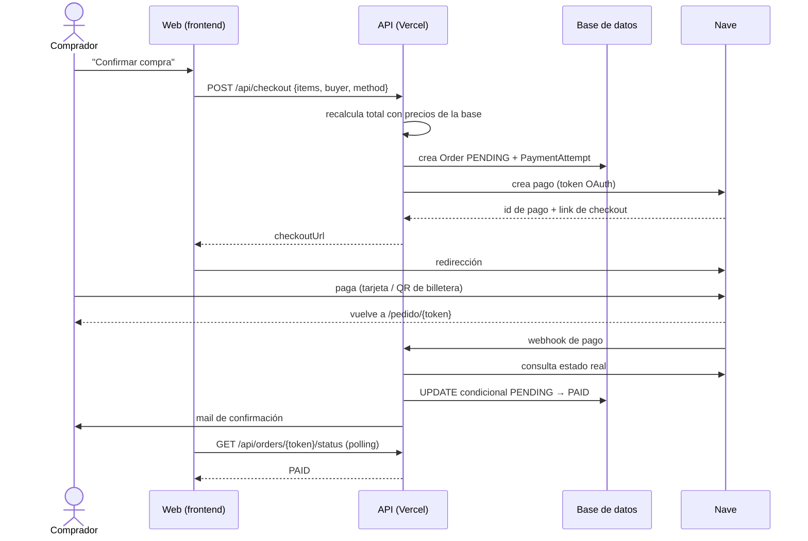

# Plan — Cobros online con Nave (checkout estilo Mercado Libre)

| | |
|---|---|
| **Estado** | Borrador v1 |
| **Fecha** | 2026-10-27 |
| **Basado en** | `spec.md` |
| **Siguiente** | `task.md` |

> **Convención:** `[A CONFIRMAR]` = depende de la documentación oficial de Nave o de una decisión pendiente. Los nombres de endpoints y campos de Nave **no están verificados**: se aíslan en `lib/nave` y se completan cuando llegue la doc.

---

## 1. Decisiones de diseño

| # | Decisión | Motivo |
|---|---|---|
| D1 | Checkout **por redirección** a Nave | Los datos de tarjeta no pasan por tu servidor; menos alcance de seguridad. |
| D2 | Una sola página "Revisá y confirmá" | Patrón Mercado Libre: flujo corto y un único botón principal. |
| D3 | Compra como **invitado** | Evita la mayor fuente de abandono. El login queda para después, opcional. |
| D4 | Estado de pago confirmado **solo** por webhook o consulta a Nave | Volver de Nave no prueba nada. |
| D5 | Una orden puede tener **varios intentos** de pago | El comprador puede cambiar de medio o reintentar. |
| D6 | Actualización **condicional e idempotente** de la orden | Evita doble stock o doble mail si el webhook llega repetido. |
| D7 | Todo acceso a Nave en un único módulo con **mock** | Se desarrolla y se prueba sin credenciales; se aísla lo no verificado. |
| D8 | Montos en **enteros (centavos)** internamente | Evita errores de redondeo. El formato que pide Nave `[A CONFIRMAR]`. |

## 2. Stack

| Capa | Elección | Estado |
|---|---|---|
| Hosting | Vercel | Ya en uso |
| Framework | Next.js (App Router) + TypeScript | **Asumido, reemplazar si es otro** |
| Base de datos | `[A DEFINIR]` (Postgres recomendado) | Pendiente |
| ORM / acceso a datos | `[A DEFINIR]` (ej. Prisma o Drizzle) | Pendiente |
| Validación | zod | Propuesto |
| Mails | `[A DEFINIR]` (ej. Resend) | Pendiente |
| Tests | Vitest + Playwright | Propuesto |

> Las rutas y firmas de este plan siguen convenciones de Next.js. Si el backend es otro (Express, etc.) se traducen 1 a 1.

## 3. Arquitectura y flujo



## 4. Estructura propuesta

```
app/
  checkout/page.tsx                    # "Revisá y confirmá"
  pedido/[token]/page.tsx              # estado del pedido (polling + 4 estados)
  api/
    checkout/route.ts                  # POST: crea orden + intento
    orders/[token]/pay/route.ts        # POST: reintentar / nuevo intento
    orders/[token]/status/route.ts     # GET: estado (con consulta a Nave si sigue PENDING)
    webhooks/nave/route.ts             # POST: notificación de Nave
    cron/reconcile/route.ts            # GET: reconciliación (protegido)
components/checkout/
  CheckoutForm.tsx · PaymentOptions.tsx · OrderSummary.tsx
  StickyConfirmBar.tsx · OrderStatus.tsx
lib/
  nave/
    index.ts            # selecciona cliente según NAVE_MODE
    types.ts            # interfaz NaveClient
    mock.ts             # cliente simulado
    http.ts             # cliente real (token, createPayment, getPayment)
    status-map.ts       # mapeo de estados de Nave → internos
  orders/
    price-cart.ts · create-order.ts · mark-paid.ts · after-paid.ts
  money.ts · token.ts · rate-limit.ts · log.ts
```

## 5. Modelo de datos

```sql
orders (
  id               uuid primary key,
  public_token     uuid unique not null,
  status           text not null check (status in ('PENDING','PAID','EXPIRED','FAILED')),
  buyer            jsonb not null,            -- nombre, mail, teléfono
  shipping         jsonb,                     -- null si retiro/digital
  subtotal_cents   integer not null,
  shipping_cents   integer not null default 0,
  total_cents      integer not null,
  currency         text not null default 'ARS',
  created_at       timestamptz not null default now(),
  paid_at          timestamptz
)

order_items (
  id               uuid primary key,
  order_id         uuid references orders(id),
  product_id       text not null,
  name_snapshot    text not null,
  unit_price_cents integer not null,
  quantity         integer not null check (quantity > 0)
)

payment_attempts (
  id               uuid primary key,
  order_id         uuid references orders(id),
  method           text not null check (method in ('wallet','card')),
  nave_request_id  text unique,               -- id del pago en Nave [A CONFIRMAR]
  checkout_url     text,
  status           text not null check (status in ('CREATED','APPROVED','REJECTED','EXPIRED','CANCELLED')),
  expires_at       timestamptz,
  created_at       timestamptz not null default now()
)

webhook_events (
  id               uuid primary key,
  nave_request_id  text,
  received_at      timestamptz not null default now(),
  payload          jsonb,
  processed        boolean not null default false
)
```

Índices: `orders(public_token)`, `orders(status, created_at)`, `payment_attempts(order_id)`, `payment_attempts(nave_request_id)`.

## 6. Contratos de API

### `POST /api/checkout`
- **Entrada:** `{ items: [{productId, qty}], buyer: {name, email, phone}, shipping?, method: "wallet" | "card" }`
- **Proceso:** validar con zod → `priceCart()` en servidor → crear orden `PENDING` + ítems → crear intento y pago en Nave → guardar `nave_request_id` y `checkout_url`.
- **Salida 200:** `{ checkoutUrl, orderToken }`
- **Errores:** `400` datos inválidos · `409` carrito inconsistente (precio o stock cambió) · `429` rate limit · `502` Nave no respondió (la orden queda `PENDING` y se puede reintentar).

### `POST /api/orders/[token]/pay`
- **Entrada:** `{ method }` (lista fija).
- **Proceso:** orden debe estar `PENDING`; si hay intento vigente con el mismo método, devolverlo; si no, crear intento nuevo en Nave.
- **Salida 200:** `{ checkoutUrl }` · **Errores:** `400` · `404` · `409` orden no disponible · `502`.

### `GET /api/orders/[token]/status`
- **Salida:** `{ status, total, items, ... }` mínimos para pintar la pantalla.
- **Comportamiento:** si la orden sigue `PENDING` y el último intento tiene más de unos segundos, consulta a Nave y actualiza (misma lógica que el webhook).

### `POST /api/webhooks/nave`
- Guarda el evento en `webhook_events`.
- **No confía en el cuerpo:** toma el identificador de pago, consulta a Nave y decide con el estado real.
- Si está aprobado → `markPaid()` (ver §8). Responde `200` rápido.
- Verificación de autenticidad según doc de Nave `[A CONFIRMAR]`.

### `GET /api/cron/reconcile`
- Requiere header `Authorization: Bearer ${CRON_SECRET}`.
- Busca órdenes `PENDING` con intentos de más de N minutos, consulta a Nave, aplica `markPaid()` o marca `EXPIRED` según corresponda.

## 7. Módulo `lib/nave`

```ts
interface NaveClient {
  createPayment(input: {
    orderRef: string;           // único por intento [A CONFIRMAR formato]
    totalCents: number;
    items: { name: string; unitPriceCents: number; qty: number }[];
    callbackUrl: string;        // /pedido/{token}
    method?: "wallet" | "card"; // si Nave permite preseleccionar [A CONFIRMAR]
    mobile?: boolean;           // [A CONFIRMAR qué hace]
  }): Promise<{ requestId: string; checkoutUrl: string; expiresAt?: Date }>;

  getPayment(requestId: string): Promise<{
    status: "APPROVED" | "REJECTED" | "EXPIRED" | "PENDING";
    raw: unknown;
  }>;
}
```

- **`mock.ts`:** comportamiento configurable (aprobado, rechazado, vencido, pendiente) + endpoint de desarrollo que dispara un webhook simulado. Activo con `NAVE_MODE=mock`.
- **`http.ts`:** obtiene token OAuth 2.0 (credenciales de cliente) y lo cachea hasta que venza; implementa las dos llamadas. URLs y campos `[A CONFIRMAR con la doc]`.
- **`status-map.ts`:** única tabla que traduce los estados de Nave a los internos.
- **Referencia:** existe un SDK comunitario no oficial (`sdk-nave-nodejs`) cuya forma de pedido (`order_id`, `callback_url`, `getOrder`) sirve de guía, pero no debe ser dependencia sin revisarlo.

## 8. Confirmación idempotente

```ts
// mark-paid.ts
async function markPaid(orderId: string, attemptId: string) {
  const { count } = await db.order.updateMany({
    where: { id: orderId, status: "PENDING" },
    data:  { status: "PAID", paidAt: new Date() },
  });
  if (count === 1) {
    await afterPaid(orderId);          // stock, mail comprador, aviso al dueño
  } else {
    await logDuplicatePayment(orderId, attemptId); // orden ya pagada → reembolso manual
  }
}
```

La misma función la usan el webhook, la consulta de estado y la reconciliación.

## 9. Frontend

- **`/checkout`**
  - Bloque 1: datos y entrega (con Editar y autocompletado desde el navegador).
  - Bloque 2: "Elegí cómo pagar" — dos opciones, una preseleccionada.
  - Bloque 3: resumen con total final y botón "Confirmar compra". En celular, barra fija inferior con total + botón.
  - Botón con estados: normal / cargando ("Te llevamos a Nave…") / error con reintento. Se deshabilita al primer toque.
- **`/pedido/[token]`**
  - Polling cada 2–3 s durante ~60 s. Pasado ese tiempo: "Estamos procesando tu pago, te avisamos por mail".
  - Estados: aprobado · procesando · rechazado · vencido; cada uno con botón (ver pedido / reintentar / volver a la tienda).
- **Accesibilidad:** inputs de 16 px o más, objetivos táctiles de 44–48 px o más, contraste AA, `autocomplete`/`inputmode` correctos, foco visible.
- **Persistencia local:** guardar datos del comprador en `localStorage` con opción de borrarlos.

## 10. Configuración de Vercel y entornos

| Variable | Descripción |
|---|---|
| `NAVE_MODE` | `mock` · `sandbox` · `production` |
| `NAVE_CLIENT_ID` / `NAVE_CLIENT_SECRET` / `NAVE_POS_ID` | Credenciales entregadas por Nave |
| `NAVE_WEBHOOK_SECRET` | Si Nave ofrece firma `[A CONFIRMAR]` |
| `SITE_URL` | Base pública para `callback_url` y webhook |
| `CRON_SECRET` | Protege `/api/cron/reconcile` |
| `DATABASE_URL` | Base de datos |
| `MAIL_API_KEY` / `OWNER_EMAIL` | Mails de confirmación y aviso |
| `PAYMENTS_ENABLED` | Feature flag para activar el botón de pago |

**Puntos a tener presentes**
- **Crons:** en el plan Hobby de Vercel corren como máximo una vez por día; el plan Pro permite frecuencias menores. Con Hobby: reconciliación al abrir `/pedido/[token]` + barrido diario.
- **Previews:** las URLs de preview están protegidas por Deployment Protection y rechazan llamadas externas. Probar webhooks en el dominio de producción con credenciales sandbox, o usar el bypass de Vercel en la URL del webhook si Nave admite query strings.
- **Entornos:** variables separadas para Preview y Production. Credenciales de producción solo en Production.
- **Secretos:** nunca en el frontend ni en el repo. Incluir `.env.example` sin valores.

## 11. Seguridad

- Total calculado y validado en el servidor.
- `method` validado contra lista fija.
- Rate limiting en `/api/checkout` y `/api/orders/*`.
- Token público con UUID v4 (no secuencial).
- Webhook: re-consulta a Nave + verificación de firma si existe.
- Logs sin datos personales sensibles; nada de datos de tarjeta.
- HTTPS en todos los endpoints (Vercel lo provee).

## 12. Estrategia de pruebas

| Nivel | Qué se prueba |
|---|---|
| Unitarias | `priceCart`, `markPaid` (idempotencia), `status-map`, `money` |
| Integración (con mock) | Aprobado · rechazado · vencido · webhook duplicado · webhook perdido recuperado por reconciliación · doble clic · carrito con precio cambiado |
| E2E (Playwright) | Flujo feliz en viewport móvil y desktop; reintento tras rechazo |
| QA en sandbox | Matriz con credenciales sandbox: cada medio de pago × cada resultado |
| Producción | Compra real de monto bajo y verificación de la acreditación en Galicia |

## 13. Observabilidad

- Log estructurado de cada transición de estado (orden e intento) con `orderId`, `attemptId`, origen (webhook / consulta / cron).
- Alerta o revisión periódica de órdenes `PENDING` de más de 1 hora.
- Lista de pagos duplicados para reembolso manual.

## 14. Despliegue

1. Desarrollo con `NAVE_MODE=mock`.
2. Sandbox con credenciales de Nave en un dominio público.
3. Producción con `PAYMENTS_ENABLED=false`; activar el flag solo después de la compra real de prueba.
4. Plan de reversa: desactivar `PAYMENTS_ENABLED` oculta el botón sin tocar el resto de la tienda.

## 15. Riesgos y mitigaciones

| Riesgo | Mitigación |
|---|---|
| Doc de Nave incompleta o distinta a lo asumido | Módulo aislado + mock; ajustar solo `lib/nave` |
| Sin preselección de medio | Bloque de pago informativo con un solo botón |
| QR en celular incómodo | Preguntar por deep link; plan B con otro medio (ej. Mercado Pago, cuyo dinero luego se transfiere a Galicia) |
| Webhook perdido | Reconciliación + consulta al abrir el pedido |
| Pagos duplicados por reintentos | Reutilizar intento vigente + registro de duplicados para reembolso manual |
| Reembolsos sin API | Proceso manual desde el panel de Nave `[A CONFIRMAR]` |

## 16. Decisiones pendientes

- Stack real del backend, base de datos y proveedor de mails.
- Respuestas de Nave (ver `spec.md` §12).
- Tipo de producto (envío / retiro / digital).
- Plan de Vercel (afecta la reconciliación).
- Facturación electrónica por venta.
