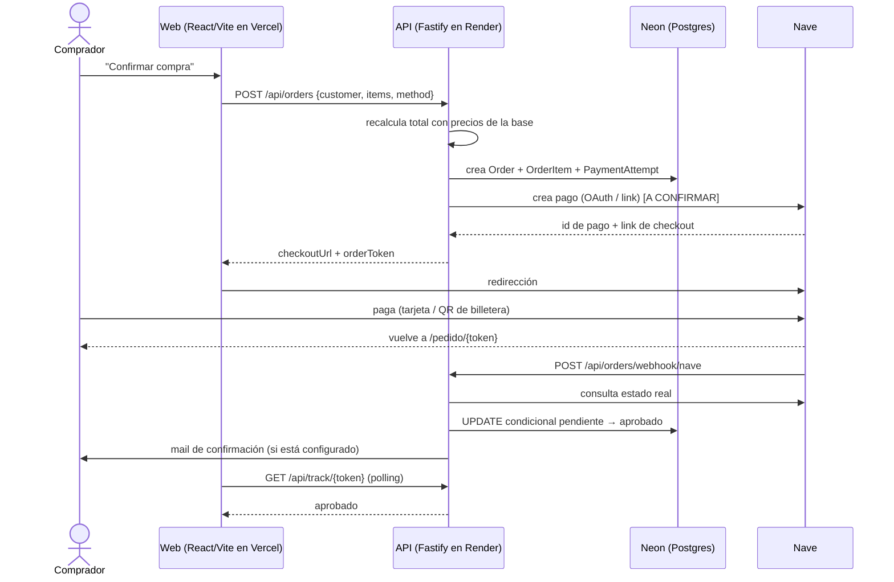

# Plan — Cobros online con Nave (checkout estilo Mercado Libre)

| | |
|---|---|
| **Estado** | borrador |
| **Fecha** | 2026-10-27 |
| **Stack corregido** | 2026-10-28 |
| **Basado en** | `spec.md` |
| **Siguiente** | `task.md` |

> **Convención:** `[A CONFIRMAR]` = depende de la documentación oficial de Nave o de una decisión pendiente. Los nombres de endpoints y campos de Nave **no están verificados**: se aíslan en `backend/src/modules/pagos/nave/` y se completan cuando llegue la doc.
>
> **Alcance técnico:** este plan **extiende el stack que ya está en producción** (React + Vite / Fastify + Prisma / Neon / Render + Vercel). **No** introduce Next.js, ni una segunda app, ni otro ORM. La versión anterior de este documento asumía Next.js por error: las secciones de stack, estructura, rutas y despliegue se corrigieron contra el código real.

## 1. Decisiones de diseño

| # | Decisión | Motivo |
|---|---|---|
| D1 | Checkout **por redirección** a Nave | Los datos de tarjeta no pasan por tu servidor; menos alcance de seguridad. |
| D2 | Una sola página "Revisá y confirmá" | Patrón Mercado Libre: flujo corto y un único botón principal. |
| D3 | Compra como **invitado** | Evita la mayor fuente de abandono. El login queda para después, opcional. |
| D4 | Estado de pago confirmado **solo** por webhook o consulta a Nave | Volver de Nave no prueba nada. |
| D5 | Una orden puede tener **varios intentos** de pago | El comprador puede cambiar de medio o reintentar. |
| D6 | Actualización **condicional e idempotente** de la orden | Evita doble stock o doble mail si el webhook llega repetido. |
| D7 | Todo acceso a Nave en un único módulo con **mock** | Se desarrolla y se prueba sin credenciales; se aísla lo no verificado. |
| D8 | Montos en **enteros, en pesos** | Es la unidad que ya usan `Order.total`, `OrderItem.price` y `Product.price` (D-15 de la spec 009). Si Nave pide centavos, la conversión vive **solo** en `nave/money.ts`; no se cambia la unidad del resto del sistema. |
| D9 | **Extender** `Order`, `OrderItem` y `Customer`; no crear tablas paralelas | El checkout, el panel y las métricas ya leen esos modelos. Un modelo nuevo obligaría a sincronizar dos verdades. |

## 2. Stack

| Capa | Elección | Estado |
|---|---|---|
| Hosting frontend | **Vercel** (SPA + rewrites + headers) | Ya en uso |
| Frontend | **React 18.2 + Vite 8 + react-router 7 + TypeScript 5** (strict) | Ya en uso |
| Hosting API | **Render** (Docker, `node:24-slim`) | Ya en uso |
| API | **Fastify 4.25 + Node 24** (ESM) | Ya en uso |
| Base de datos | **PostgreSQL 16 en Neon** | Ya en uso |
| ORM | **Prisma 5.8** (`DATABASE_URL` pooled + `DIRECT_URL` para migraciones) | Ya en uso |
| Validación | **Zod 3** en backend · **Zod 4** en frontend | Ya en uso |
| Pagos | Interfaz **`ProveedorPagos`** + módulo `nave` | A extender |
| HTTP hacia Nave | **`fetch` global de Node 24** | Ya disponible |
| Rate limit | **`@fastify/rate-limit`** (ya registrado) | Ya en uso |
| Mails | `[A DEFINIR]` — hoy no hay proveedor; el MVP puede salir sin mails | Pendiente |
| Tests | **Vitest 1** (backend) + **Vitest 5 / jsdom** (frontend) | Ya en uso |
| E2E | Playwright `[A DEFINIR]` — suma una dependencia; no es requisito del MVP | Pendiente |

> **Regla de dependencias:** si una tarea pide un paquete nuevo (SDK de Nave, cliente HTTP, Playwright, Resend), se justifica antes de instalarlo. Node 24 ya trae `fetch`, así que **no** hace falta cliente HTTP. El SDK comunitario `sdk-nave-nodejs` **no** se usa: no es oficial.

## 3. Arquitectura y flujo



## 4. Estructura propuesta

```text
src/                                    # frontend (Vite)
  pages/checkout.tsx                    # ya existe: se extiende con el medio de pago
  pages/pedido.tsx                      # nueva: estado del pedido
  components/checkout/                  # CheckoutForm · PaymentOptions · OrderSummary
                                        # StickyConfirmBar · OrderStatus
  router.tsx                            # agrega la ruta /pedido/:token

backend/src/
  modules/pagos/
    proveedor.ts                        # interfaz existente (no se rompe)
    nave/
      index.ts                          # elige cliente según NAVE_MODE
      types.ts                          # interfaz NaveClient
      mock.ts                           # cliente simulado
      http.ts                           # cliente real (fetch + OAuth)
      status-map.ts                     # estados de Nave → EstadoPago
      money.ts                          # pesos ↔ unidad de Nave [A CONFIRMAR]
  modules/orders/
    routes.ts                           # POST /api/orders · /api/track/* · webhook nave
    service.ts                          # crearPedido + aplicarPago (se extienden)
  config/env.ts                         # NAVE_* + PAYMENTS_ENABLED

backend/prisma/schema.prisma            # Order.publicToken + PaymentAttempt + WebhookEvent
```

**No se duplica nada de lo que ya existe:**

- El cálculo del total y la validación de stock ya viven en `crearPedido` (`modules/orders/service.ts`). No hace falta un `price-cart.ts` aparte: se reusa y se le agrega el intento de pago.
- La confirmación idempotente ya existe en `aplicarPago` (webhook de Mercado Pago). El webhook de Nave y la reconciliación llaman a la **misma** función.
- El rate limit del checkout ya está (`ORDER_RATE_MAX`, 10/min por IP).

## 5. Modelo de datos

Se extiende el esquema Prisma existente. **No** se crean tablas `orders` / `order_items` nuevas.

```prisma
// Existente — se le agrega el token público
model Order {
  id              String          @id @default(cuid())
  customerId      String
  total           Int             // pesos enteros (no centavos)
  status          OrderStatus     @default(pendiente)
  pagoEstado      EstadoPago      @default(no_iniciado)
  pagoId          String?         @unique
  shippingAddress Json
  createdAt       DateTime        @default(now())
  updatedAt       DateTime        @updatedAt

  /// Token público para /api/track/:token. UUID v4, no secuencial.
  publicToken     String?         @unique @default(uuid())

  attempts        PaymentAttempt[]
  // ...items, customer, timeline (ya existen)
}

// Nueva — varios intentos por orden (D5)
model PaymentAttempt {
  id            String     @id @default(cuid())
  orderId       String
  order         Order      @relation(fields: [orderId], references: [id], onDelete: Cascade)
  method        String     // 'wallet' | 'card' | 'link'
  naveRequestId String?    @unique
  checkoutUrl   String?
  estado        EstadoPago @default(no_iniciado)
  expiresAt     DateTime?
  createdAt     DateTime   @default(now())

  @@index([orderId])
  @@index([estado, createdAt])
}

// Nueva — auditoría de webhooks (FR-011)
model WebhookEvent {
  id            String   @id @default(cuid())
  naveRequestId String?
  receivedAt    DateTime @default(now())
  payload       Json
  processed     Boolean  @default(false)

  @@index([naveRequestId])
  @@index([processed, receivedAt])
}
```

**Estados:** se reusa el enum `EstadoPago` (`no_iniciado`, `pendiente`, `aprobado`, `rechazado`, `expirado`). No se inventa un `PENDING/PAID` paralelo: el panel y los badges ya hablan ese idioma.

## 6. Contratos de API

### `POST /api/orders` (existente, público)

- **Entrada:** la actual (`customer`, `items`, `shippingAddress?`) + `method?: "wallet" | "card" | "link"`.
- **Proceso:** Zod → `crearPedido` (total y stock desde la base) → crear `PaymentAttempt` → crear pago en Nave → guardar `naveRequestId` y `checkoutUrl`.
- **Salida 201:** `{ orderId, orderToken, checkoutUrl }`. Sin `checkoutUrl` si `PAYMENTS_ENABLED=false` (modo manual actual).
- **Errores:** `400` datos inválidos · `409` carrito inconsistente (precio o stock cambió) · `429` rate limit · `502` Nave no respondió (la orden queda `pendiente` y se puede reintentar).

### `GET /api/track/:token` (nueva, pública)

- `token` = `Order.publicToken`. **No** colisiona con `GET /api/orders/:id` (esa es del panel y exige rol).
- **Salida:** `{ estado, total, items, checkoutUrl? }` mínimos para pintar la pantalla.
- **Comportamiento:** si sigue `pendiente`, consulta a Nave y actualiza con `aplicarPago`.

### `POST /api/track/:token/pay` (nueva, pública)

- Reutiliza el intento vigente del mismo método o crea uno nuevo; solo si la orden sigue `pendiente`.
- **Errores:** `404` · `409` orden no disponible · `502`.

### `POST /api/orders/webhook/nave` (nueva, pública)

- Guarda el evento en `WebhookEvent`.
- **No confía en el cuerpo:** toma el identificador de pago, consulta a Nave y decide con el estado real.
- Verificación de autenticidad según doc de Nave `[A CONFIRMAR]` (si hay firma, mismo patrón que la webhook de Mercado Pago: HMAC + ventana de frescura).
- Responde `200` rápido. No colisiona con `POST /api/orders/webhook` (Mercado Pago).

### Reconciliación

- **Cron in-process** con `setInterval(...).unref()`, igual que la expiración de la spec 009: Render free no tiene cronjobs y el proceso se duerme sin tráfico.
- Además, `POST /api/orders/reconcile` con `requireRole('admin')` para forzar una pasada a mano desde el panel.

## 7. Módulo `backend/src/modules/pagos/nave`

```ts
export interface NaveClient {
  createPayment(input: {
    orderRef: string            // único por intento [A CONFIRMAR formato]
    total: number               // pesos enteros
    items: { name: string; unitPrice: number; qty: number }[]
    callbackUrl: string         // FRONTEND_ORIGIN/pedido/{token}
    method?: 'wallet' | 'card' | 'link'  // si Nave permite preseleccionar [A CONFIRMAR]
  }): Promise<{ requestId: string; checkoutUrl: string; expiresAt?: Date }>

  getPayment(requestId: string): Promise<{
    estado: 'aprobado' | 'rechazado' | 'expirado' | 'pendiente' | 'desconocido'
    monto: number
    raw: unknown
  }>
}
```

- **`mock.ts`:** comportamiento configurable (aprobado, rechazado, vencido, pendiente) + endpoint de desarrollo que dispara un webhook simulado. Activo con `NAVE_MODE=mock`.
- **`http.ts`:** token OAuth 2.0 cacheado hasta su vencimiento + las dos llamadas, usando `fetch`. URLs y campos `[A CONFIRMAR con la doc]`.
- **`status-map.ts`:** única tabla que traduce los estados de Nave a `EstadoPago`.
- **`money.ts`:** única tabla que traduce pesos enteros a la unidad de Nave `[A CONFIRMAR]`.
- **`index.ts`:** elige el cliente según `NAVE_MODE` (`mock` · `sandbox` · `production`).

## 8. Confirmación idempotente

Se integra en `aplicarPago` (`modules/orders/service.ts`), que ya hace la transición condicional:

```ts
const { count } = await prisma.order.updateMany({
  where: {
    id: orderId,
    pagoEstado: { in: ['no_iniciado', 'pendiente', 'expirado'] }
  },
  data: { pagoEstado: 'aprobado' }
})

if (count === 1) {
  await afterPaid(orderId)          // stock, mail comprador, aviso al dueño
} else {
  await logDuplicatePayment(orderId, attemptId) // ya pagada → reembolso manual
}
```

Los estados terminales (`aprobado`, `rechazado`) no se abandonan: un replay viejo no degrada una orden resuelta. La misma función la usan el webhook, la consulta de estado y la reconciliación.

## 9. Frontend

- **`/checkout`** (`src/pages/checkout.tsx`, ya existe)
  - Bloque 1: datos y entrega (con Editar y autocompletado desde el navegador).
  - Bloque 2: "Elegí cómo pagar" — dos opciones, una preseleccionada.
  - Bloque 3: resumen con total final y botón "Confirmar compra". En celular, barra fija inferior con total + botón.
  - Botón con estados: normal / cargando ("Te llevamos a Nave…") / error con reintento. Se deshabilita al primer toque.
- **`/pedido/:token`** (`src/pages/pedido.tsx`, nueva)
  - Polling cada 2–3 s durante ~60 s. Pasado ese tiempo: "Estamos procesando tu pago, te avisamos por mail".
  - Estados: aprobado · procesando · rechazado · vencido; cada uno con botón (ver pedido / reintentar / volver a la tienda).
- **Accesibilidad:** inputs de 16 px o más, objetivos táctiles de 44–48 px o más, contraste AA, `autocomplete`/`inputmode` correctos, foco visible.
- **Persistencia local:** guardar datos del comprador en `localStorage` con opción de borrarlos (el carrito ya usa `localStorage`).

## 10. Configuración y entornos

Las variables del backend van en **dos lugares**: el schema de `backend/src/config/env.ts` y `backend/.env.example`. `deploy.test.ts` exige que estén en los dos, así que una variable nueva sin documentar rompe los tests.

| Variable | Descripción | Dónde |
|---|---|---|
| `NAVE_MODE` | `mock` · `sandbox` · `production` | Backend |
| `NAVE_CLIENT_ID` / `NAVE_CLIENT_SECRET` / `NAVE_POS_ID` | Credenciales entregadas por Nave | Backend (Render) |
| `NAVE_WEBHOOK_SECRET` | Si Nave ofrece firma `[A CONFIRMAR]` | Backend (Render) |
| `PAYMENTS_ENABLED` | Feature flag para activar el botón de pago | Backend |
| `NAVE_CODIGO_COBRO` / `NAVE_QR_URL` / `NAVE_LINK_COBRO` | Modo manual actual (`PAGO_MODO=nave`) | **Ya existen** |
| `FRONTEND_ORIGIN` | Base de `callback_url` y de las `back_urls` | **Ya existe** |
| `PUBLIC_API_URL` | Base pública para la URL del webhook | **Ya existe** |
| `DATABASE_URL` / `DIRECT_URL` | Base pooled / migraciones | **Ya existen** |
| `VITE_API_URL` | URL de la API que usa el frontend | **Ya existe** (Vercel) |

**Puntos a tener presentes**

- **Cron:** in-process. No se configura nada en Vercel; el barrido corre dentro del proceso de Render.
- **Render free se duerme:** el primer request (o el webhook de Nave) tarda en despertar. Si Nave reintenta webhooks, conviene que la ventana de reintento sea mayor al cold start `[A CONFIRMAR]`.
- **Previews:** el frontend de preview de Vercel está protegido; la API no está en Vercel, así que el webhook apunta siempre a `PUBLIC_API_URL` (Render). Probar con credenciales sandbox contra el deploy de Render.
- **Entornos:** credenciales de producción solo en Render (Production). El `.env` local nunca las lleva.
- **Secretos:** nunca en el frontend ni en el repo. `.env.example` sin valores.

## 11. Seguridad

- Total calculado y validado en el servidor (ya existe).
- `method` validado contra lista fija.
- Rate limit en `POST /api/orders`, `/api/track/*` y el webhook (`@fastify/rate-limit`, ya registrado).
- Token público con UUID v4 (no secuencial), separado del `id` interno.
- Webhook: re-consulta a Nave + verificación de firma si existe + ventana de frescura.
- `response.schema` completo: en Fastify un schema parcial **corta** los datos (`objetoLibre()` existe por eso). No escribir `{ type: 'object' }` a secas.
- Logs sin datos personales sensibles; nada de datos de tarjeta.
- HTTPS en todos los endpoints (Vercel y Render lo proveen).

## 12. Estrategia de pruebas

| Nivel | Qué se prueba |
|---|---|
| Unitarias | `status-map`, `money`, `aplicarPago` (idempotencia) |
| Integración con mock | Aprobado · rechazado · vencido · webhook duplicado · webhook perdido recuperado por reconciliación · doble clic · carrito con precio cambiado |
| E2E (`[A DEFINIR]`) | Flujo feliz en viewport móvil y desktop; reintento tras rechazo. Solo si se justifica Playwright. |
| QA en sandbox | Matriz con credenciales sandbox: cada medio de pago × cada resultado |
| Producción | Compra real de monto bajo y verificación de la acreditación en Galicia |

Los tests usan `NAVE_MODE=mock` (llenan `PaymentAttempt`/`WebhookEvent`), igual que la spec 009 usa `ProveedorPagosFalso` en vez de Mercado Pago real.

## 13. Observabilidad

- Log estructurado (Pino) de cada transición de estado, con `orderId`, `attemptId` y origen (webhook / consulta / cron).
- Alerta o revisión periódica de órdenes `pendiente` de más de 1 hora.
- Lista de pagos duplicados para reembolso manual.

## 14. Despliegue

1. Desarrollo con `NAVE_MODE=mock`.
2. Sandbox con credenciales de Nave en Render (dominio público de la API).
3. Producción con `PAYMENTS_ENABLED=false`; activar el flag solo después de la compra real de prueba.
4. Plan de reversa: desactivar `PAYMENTS_ENABLED` oculta el botón sin tocar el resto de la tienda.
5. Las migraciones nuevas (`publicToken`, `PaymentAttempt`, `WebhookEvent`) corren solas en el arranque (`prisma migrate deploy`).

## 15. Riesgos y mitigaciones

| Riesgo | Mitigación |
|---|---|
| Doc de Nave incompleta o distinta a lo asumido | Módulo aislado + mock; ajustar solo `modules/pagos/nave` |
| Sin preselección de medio | Bloque de pago informativo con un solo botón |
| QR en celular incómodo | Preguntar por deep link; plan B con otro medio |
| Webhook perdido | Reconciliación in-process + consulta al abrir el pedido |
| Render free dormido durante un webhook | Reintentos de Nave + reconciliación posterior |
| Pagos duplicados por reintentos | Reutilizar intento vigente + registro de duplicados para reembolso manual |
| Reembolsos sin API | Proceso manual desde el panel de Nave `[A CONFIRMAR]` |
| Agregar una dependencia sin justificar | Regla de §2: se justifica antes; `fetch` cubre el HTTP |

## 16. Decisiones pendientes

- Proveedor de mails (hoy no hay; el MVP puede salir sin mails).
- Respuestas de Nave (ver `spec.md` §12).
- Tipo de producto (envío / retiro / digital).
- Facturación electrónica por venta.
